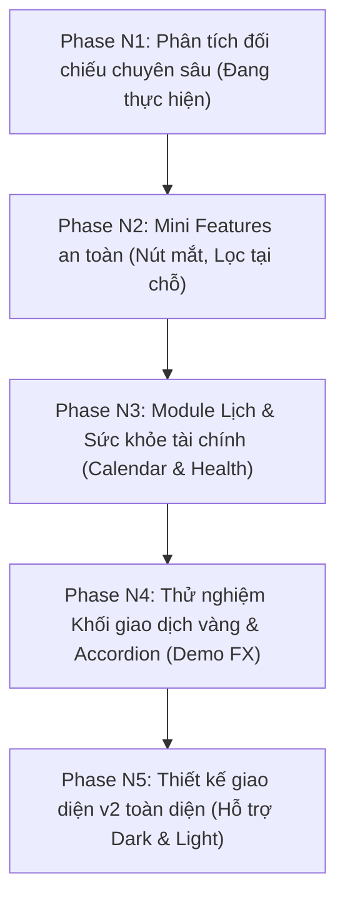

# Phân tích Chuyên sâu Bản Thiết kế Mock ChiLi v2 (chili-v2.html) so với Ứng dụng ChiLi Hiện tại

> **Tài liệu phân tích kỹ thuật & trải nghiệm người dùng (UX/UI)**  
> **Tham chiếu mock:** `raw/redesign/chili-v2.html` (Bản mock HTML đơn trang dùng Tailwind CSS, Google Fonts, Lucide Icons)  
> **Ứng dụng hiện tại:** ChiLi Android (Kotlin, Jetpack Compose, Room DB v4, Material 3, Dark-first theme)  
> **Quy tắc ràng buộc:** `docs/ui-layout.md`, `task_plan.txt` (Phase T, X, 4B, D), `AGENTS.md`

---

## A. Tổng quan bản mock (Mock Screen-by-Screen Summary)

Bản mock `raw/redesign/chili-v2.html` là một trang web mô phỏng giao diện ứng dụng di động trên khung máy tỷ lệ ~9:19.5 (max-width 400px, height 844px). Phong cách thị giác mang tính hiện đại, năng động, dùng tone màu sáng (light-first), độ tương phản cao với màu xanh lá đậm (`#00B159`), xanh cốm chanh (`#98F53E` -> `#75DC21`), vàng rực rỡ (`#FFD95A`) và các lớp bề mặt xám nhạt/trắng (`#F8FAFC`, `#E2E8F0`).

Cấu trúc phân tầng và luồng tương tác của bản mock gồm các khối sau:

### 1. Khung hiển thị & Thanh trạng thái (Status Bar & Dynamic Island)
- Mô phỏng thanh trạng thái di động: đồng hồ, icon thông báo, notch/dynamic island, vạch sóng, wifi và phần trăm pin.
- Phía dưới là thanh thông báo Toast nổi nội bộ app (`app-toast`) xuất hiện khi có tương tác (đổi ngày, đổi ngân sách).

### 2. Tầng 1 Header cố định (Sticky Top Bar)
- Nằm cố định trên đỉnh màn hình (z-index 40), không bị cuộn trôi.
- Bên trái: Đèn tín hiệu xanh lime nhấp nháy (`animate-pulse`) và nhãn trạng thái bộ lọc ngữ cảnh (`header-filter-label`): mặc định là "Tất cả nguồn tiền", khi chọn tài khoản đổi thành "Đang lọc: [Tên tài khoản]", khi sang trang Lịch đổi thành "Sức khỏe tài chính".
- Bên phải: Viên thuốc phân đoạn (Segmented Pill) chứa 2 nút: **Tài khoản** (`btn-mode-accounts`) và **Lịch** (`btn-mode-calendar`) dùng để chuyển đổi giữa 2 trang của Horizontal Pager.

### 3. Bộ chuyển trang ngang (Horizontal Pager Viewport)
Chứa 2 trang nội dung toàn màn hình, hỗ trợ cả bấm nút trên header lẫn vuốt ngang (swipe left/right):

#### Trang 0: Tài khoản & Dashboard tổng quan (Collapsing Header + White Sheet)
- **Tầng 2 Header (Account Carousel Layer):** Nằm ngay dưới sticky top bar trên nền xanh lá gradient. Chứa danh sách cuộn ngang (`overflow-x-auto`) các thẻ tài khoản:
  + Thẻ Tiền mặt (`acc-card-cash`): icon banknote, số dư NT$30,000, có chấm badge chọn (`badge-cash`).
  + Thẻ Ngân hàng (`acc-card-bank`): icon landmark, số dư NT$100,000, có chấm badge chọn (`badge-bank`).
  + Nút "+" Thêm tài khoản mới: nút vuông bo góc nhỏ gọn.
  + **Cơ chế Collapsing Header:** Khi cuộn nội dung bên dưới xuống, tầng nội dung màu trắng sẽ trượt lên che khuất carousel này, thu gọn không gian chỉ còn thanh Tầng 1 Header.
- **Tầng nội dung trượt màu trắng (White Sheet Container):**
  + Bo góc trên 32dp (`rounded-t-[32px]`), có tay nắm kéo trực quan (`sheet-drag-handle`).
  + Vùng cuộn độc lập (`white-sheet-scroll`), chứa:
    1. **Hero Card Tổng số dư (Xanh cốm gradient):**
       - Tiêu đề "Tổng số dư" kèm tag tài khoản ("Tất cả" hoặc tên ví).
       - Nút con mắt ẩn/hiện số dư (`btn-toggle-eye` với icon `eye` / `eye-off`).
       - Số dư lớn màu xanh dương đậm (`#1D4ED8`, cỡ chữ 31px).
       - Dòng phân bổ tiền: "Tự do: NT$40,000 • Giữ trong hũ: NT$90,000".
       - Khối "Còn được tiêu kỳ này": click để xem trạng thái ngân sách hoặc tạo ngân sách.
       - Hai viên thuốc con nhộng Thu nhập (`#00A859`) và Chi tiêu (`#FF5252`).
    2. **Khối Giao dịch màu vàng hợp nhất (Unified Expandable Yellow Card):**
       - Card bo góc 26dp màu vàng tươi (`#FFD95A`), tích hợp danh sách giao dịch trực tiếp trong lòng card.
       - Thanh header: Nút mở rộng/thu gọn dạng accordion (`tx-chevron-wrap`), tiêu đề "Giao dịch", badge đếm số lượng (`tx-count-badge`).
       - Bộ điều hướng ngày dạng stepper `< 14/11/2026 >` (`current-date-display`) chuyển đổi qua lại giữa từng ngày đơn lẻ.
       - Thân accordion chứa danh sách giao dịch của ngày đã chọn: icon danh mục, tên giao dịch, nhãn tài khoản, giờ giao dịch, số tiền (+/-).
    3. **Card Mẹo quản lý chi tiêu:** Gợi ý vuốt lên để thu gọn danh sách ví.

#### Trang 1: Lịch & Sức khỏe tài chính (Calendar & Financial Health)
- **Thẻ Điểm Sức khỏe Tài chính:** Nền gradient xanh lá đậm, điểm đánh giá "Rất tốt • 86/100", số thặng dư dòng tiền (+NT$130,000), tỷ lệ tiết kiệm (86.6%), nhãn tháng 11/2026.
- **Khối Lịch dòng tiền tháng (Calendar Days Grid):**
  + Tiêu đề tháng 11/2026 kèm chú thích chấm xanh (Thu) và chấm đỏ (Chi).
  + Lưới 7 cột (T2 -> CN) hiển thị toàn bộ 30 ngày trong tháng. Ngày có giao dịch có chấm xanh/đỏ phía dưới số ngày.
  + Ngày đang chọn được highlight nền xanh lá đậm.
  + Khối tóm tắt ngày được chọn: hiển thị ngày, số giao dịch, tổng thu và tổng chi của ngày đó.
- **Biểu đồ cột Thu - Chi theo tuần:** 4 tuần trong tháng, mỗi tuần gồm 2 cột (cột xanh lá là Thu, cột đỏ hồng là Chi).
- **Biểu đồ tròn Donut Chart (SVG):** Cơ cấu phân bổ dòng tiền: Giữ trong hũ (69% - NT$90k) vs Tiền tự do (31% - NT$40k).

### 4. Nút bấm nổi FAB ("+")
- Nằm cố định ở góc dưới phải (cách đáy 84px), màu xanh mòng két teal (`#33999E`), icon dấu cộng màu vàng nhạt (`#FFF3D6`).
- Trong bản mock, nút này đóng vai trò thẩm mỹ (chưa gán sự kiện mở form ghi chép).

### 5. Thanh điều hướng đáy (Bottom Navigation Bar)
- Cố định ở đáy màn hình, gồm 4 tab:
  1. **Trang chủ** (Home - icon nhà - active)
  2. **Ví tiền** (Wallet - icon ví)
  3. **Kho hũ** (Jars - icon heo đất)
  4. **Khác** (More - icon layout grid)

---

## B. Bảng đối chiếu song song (Side-by-Side Mapping Table)

Bảng dưới đây ánh xạ toàn bộ **38 element ID** trích xuất từ `raw/redesign/chili-v2.html`, các khối giao diện bổ trợ của mock, và toàn bộ các tính năng hiện có trong ChiLi nhưng không xuất hiện trong mock:

| STT | Mock Element (ID / Khối) | ChiLi Hiện tại (Path:Line tương đương) | Trạng thái (Status) | Ghi chú so sánh kỹ thuật & hành vi |
|:---:|---|---|:---:|---|
| 1 | `acc-card-bank` | `ui/home/AccountsPage.kt:458-464` (`AccountTile`) | **CHANGED BEHAVIOUR** | ChiLi: Tile trong grid dọc 3 cột, bấm mở tab Giao dịch lọc theo ví, nhấn giữ sửa. Mock: Thẻ ngang trong carousel, bấm lọc in-place trên dashboard Trang chủ. |
| 2 | `acc-card-cash` | `ui/home/AccountsPage.kt:458-464` (`AccountTile`) | **CHANGED BEHAVIOUR** | Tương tự thẻ ngân hàng; kiểu dáng mock bo góc tròn mềm hơn (22dp), nền xám sáng, icon Lucide `banknote`. |
| 3 | `account-carousel-layer` | `ui/home/AccountsPage.kt:432-468` (`LazyVerticalGrid`) | **CHANGED LOOK** | ChiLi: Grid dọc cuộn chung toàn trang. Mock: Carousel cuộn ngang nằm ở header xanh, bị che khuất khi sheet trắng trượt lên. |
| 4 | `app-toast` | Android System Toast / Snackbar | **CHANGED LOOK** | ChiLi dùng Toast hệ thống Android. Mock dùng custom overlay pill nổi trên top bar (`top-14`). |
| 5 | `badge-bank` | *(Chưa có trong ChiLi)* | **NEW** | Chấm tròn xanh nhỏ góc trên thẻ tài khoản biểu thị tài khoản này đang được lọc. |
| 6 | `badge-cash` | *(Chưa có trong ChiLi)* | **NEW** | Tương tự `badge-bank`. |
| 7 | `btn-mode-accounts` | `ui/home/HomeScreen.kt:64-84` (Segmented pill Tab 0) | **CHANGED LOOK** | Chuyển đổi sang trang 0 của Horizontal Pager; ChiLi dùng pill card nằm dưới top bar, mock tích hợp lên sticky header. |
| 8 | `btn-mode-calendar` | `ui/home/HomeScreen.kt:64-84` (Segmented pill Tab 1) | **CHANGED BEHAVIOUR** | ChiLi: Trang 1 là "Ngân sách" (`PlanPage.kt`). Mock: Trang 1 là "Lịch" (Calendar & Financial Health). |
| 9 | `btn-toggle-eye` | *(Phase T1/T2 kế hoạch: `task_plan.txt:110-112`)* | **NEW** | Nút con mắt bật/tắt ẩn số dư thành `******`. Đã lên kế hoạch ở Phase T nhưng chưa merge code vào màn hình. |
| 10 | `budget-status-text` | `ui/home/AccountsPage.kt:278-327` (Box "Còn được tiêu") | **CHANGED LOOK** | ChiLi: Khối màu tối `surfaceContainerLowest`, hiển thị số dư còn lại hoặc nút "Tạo ngân sách". Mock: Dòng text nhỏ trong ô trắng mờ trên Hero card. |
| 11 | `cal-detail-date` | *(Chưa có trong ChiLi)* | **NEW** | Nhãn ngày đang chọn trong trang Lịch dòng tiền (VD: "Ngày 14/11/2026 (Hôm nay)"). |
| 12 | `cal-detail-in` | *(Chưa có trong ChiLi)* | **NEW** | Tổng thu nhập của ngày đang chọn trong trang Lịch (VD: "+NT$150,000"). |
| 13 | `cal-detail-note` | *(Chưa có trong ChiLi)* | **NEW** | Ghi chú tóm tắt số lượng giao dịch của ngày đang chọn trên Lịch. |
| 14 | `cal-detail-out` | *(Chưa có trong ChiLi)* | **NEW** | Tổng chi tiêu của ngày đang chọn trong trang Lịch (VD: "-NT$20,000"). |
| 15 | `calendar-days-grid` | *(Chưa có trong ChiLi)* | **NEW** | Lưới lịch 7 cột (T2-CN) hiển thị 30 ngày kèm chấm chỉ báo dòng tiền xanh (Thu) / đỏ (Chi). |
| 16 | `calendar-selected-summary` | *(Chưa có trong ChiLi)* | **NEW** | Khối container tóm tắt dòng tiền của ngày đang chọn dưới lưới lịch. |
| 17 | `current-date-display` | `ui/transactions/TransactionsScreen.kt:95-100` | **CHANGED BEHAVIOUR** | ChiLi: Chuyển tháng / chọn khoảng ngày `dd/MM - dd/MM`. Mock: Stepper chuyển từng ngày đơn `< dd/MM/yyyy >` trên khối vàng. |
| 18 | `eye-icon` | *(Chưa có trong ChiLi)* | **NEW** | Icon con mắt (`eye` / `eye-off`) thay đổi trạng thái khi toggle. |
| 19 | `header-filter-label` | `ui/components/TopBar.kt:20` (`ChiLiTopBar`) | **CHANGED LOOK** | ChiLi hiển thị title cố định "Trang chủ". Mock hiển thị trạng thái lọc động ("Tất cả nguồn tiền" / "Đang lọc: ..."). |
| 20 | `hero-account-tag` | *(Chưa có trong ChiLi)* | **NEW** | Pill nhỏ "Tất cả" hoặc tên tài khoản nằm cạnh tiêu đề "Tổng số dư" trên Hero card. |
| 21 | `hero-expense` | `ui/home/AccountsPage.kt:383-426` (Tile Chi tiêu) | **CHANGED LOOK** | ChiLi: Ô vuông bo góc tối `surfaceVariant`, icon đỏ. Mock: Viên thuốc con nhộng đỏ tươi `#FF5252`, bo tròn hoàn toàn. |
| 22 | `hero-free-amount` | `ui/home/AccountsPage.kt:244-249` ("Tự do: X") | **SAME** | Cùng biểu thị số tiền tự do sau khi trừ hũ (`freeByCurrency`). Mock đổi vị trí lên trên ô ngân sách. |
| 23 | `hero-income` | `ui/home/AccountsPage.kt:335-379` (Tile Thu nhập) | **CHANGED LOOK** | ChiLi: Ô vuông bo góc tối `surfaceVariant`, icon mint. Mock: Viên thuốc con nhộng xanh lá `#00A859`, bo tròn hoàn toàn. |
| 24 | `hero-jar-amount` | `ui/home/AccountsPage.kt:257-262` ("Giữ chỗ trong hũ: Y") | **SAME** | Cùng biểu thị số tiền đang giữ chỗ trong hũ (`reservedByCurrency`). |
| 25 | `hero-total-balance` | `ui/home/AccountsPage.kt:231-237` (Headline số dư) | **CHANGED LOOK** | Dữ liệu như nhau; ChiLi hiển thị font hệ thống màu `onSurface` trên nền tối, mock hiển thị màu xanh dương đậm `#1D4ED8` trên nền xanh cốm. |
| 26 | `horizontal-pager-viewport` | `ui/home/HomeScreen.kt:87-100` (`HorizontalPager`) | **CHANGED BEHAVIOUR** | ChiLi: Pager giữa Tài khoản & Ngân sách. Mock: Pager giữa Tài khoản & Lịch. |
| 27 | `pager-track` | `ui/home/HomeScreen.kt:87` (`rememberPagerState`) | **SAME** | Cùng là cơ chế trượt ngang giữa 2 trang. |
| 28 | `phone-frame` | `ui/FinanceApp.kt:83` (`Scaffold`) | **CHANGED LOOK** | Khung viền giả lập điện thoại trên web; trong app native Compose dùng trực tiếp cửa sổ ứng dụng và insets hệ thống. |
| 29 | `sheet-drag-handle` | *(Chưa có trong ChiLi)* | **NEW** | Tay nắm kéo của bottom sheet màu trắng trượt đè lên carousel. |
| 30 | `status-time` | Android System Status Bar | **NEW** | Giả lập đồng hồ status bar trên web; app native dùng System Status Bar của Android. |
| 31 | `sticky-top-bar` | `ui/components/TopBar.kt:20` & `HomeScreen.kt:50` | **CHANGED LOOK** | ChiLi dùng TopBar phẳng truyền thống. Mock gộp trạng thái lọc và segmented tabs vào 1 dải xanh cố định. |
| 32 | `transaction-list` | `ui/transactions/TransactionsScreen.kt:265-350` | **CHANGED BEHAVIOUR** | ChiLi: Danh sách cuộn toàn trang ở tab riêng, phân nhóm theo ngày. Mock: Danh sách rút gọn lồng trong lòng khối màu vàng. |
| 33 | `tx-accordion-body` | *(Chưa có trong ChiLi)* | **NEW** | Vùng thân co giãn (accordion expand/collapse) chứa danh sách giao dịch bên trong khối vàng. |
| 34 | `tx-chevron-wrap` | *(Chưa có trong ChiLi)* | **NEW** | Mũi tên xoay biểu thị trạng thái mở/đóng của khối giao dịch vàng. |
| 35 | `tx-count-badge` | *(Chưa có trong ChiLi)* | **NEW** | Huy hiệu số lượng giao dịch của ngày đang chọn (VD: "4"). |
| 36 | `unified-yellow-card` | *(Chưa có trong ChiLi)* | **NEW** | Khối container màu vàng tươi `#FFD95A` hợp nhất accordion và danh sách giao dịch trên Trang chủ. |
| 37 | `white-sheet-container` | `ui/home/AccountsPage.kt:160` (`LazyVerticalGrid`) | **CHANGED BEHAVIOUR** | ChiLi dùng lưới phẳng cuộn dọc. Mock dùng Sheet trắng trượt đè lên carousel khi cuộn. |
| 38 | `white-sheet-scroll` | `ui/home/AccountsPage.kt:160` | **SAME** | Vùng cuộn chứa nội dung chính của trang Tài khoản. |
| 39 | Nút FAB dấu "+" | `ui/FinanceApp.kt:124-128` (`FloatingActionButton`) | **CHANGED LOOK** | ChiLi: FAB mint `#00D09C` mở `AddTransactionScreen`. Mock: FAB teal `#33999E` chữ vàng nhạt `#FFF3D6`, đặt vị trí tuyệt đối. |
| 40 | Bottom Navigation Bar | `ui/FinanceApp.kt:86-120` (`NavigationBar`) | **CHANGED BEHAVIOUR** | ChiLi: 4 tab [Trang chủ, Giao dịch, Kho hũ, Cài đặt]. Mock: 4 tab [Trang chủ, Ví tiền, Kho hũ, Khác]. |
| 41 | Card Sức khỏe tài chính | *(Chưa có trong ChiLi)* | **NEW** | Card hiển thị điểm số tài chính 86/100, tỷ lệ tiết kiệm 86.6%, thặng dư dòng tiền trên trang Lịch. |
| 42 | Biểu đồ Thu - Chi tuần | *(Dự kiến Phase X4 `task_plan.txt:75`)* | **NEW** | Biểu đồ cột so sánh Thu vs Chi theo 4 tuần trong tháng. |
| 43 | Biểu đồ Donut phân bổ | *(Chưa có trong ChiLi)* | **NEW** | Biểu đồ tròn SVG thể hiện tỷ trọng Tiền trong hũ (69%) vs Tiền tự do (31%). |
| 44 | Card Mẹo quản lý chi tiêu | *(Đã từng bị loại bỏ ở Phase Y `task_plan.txt:88`)* | **NEW** | Card mẹo nhỏ phía dưới khối vàng. Quy tắc Phase Y/Z trước đây đã thống nhất không đưa tip cards vào app. |
| 45 | Nút "+" thêm ví trên carousel | `ui/home/AccountsPage.kt:466` (`AddAccountTile`) | **CHANGED LOOK** | ChiLi: Tile dạng nét đứt / outlined cuối grid. Mock: Nút vuông nhỏ gọn nằm ngay trong carousel cuộn ngang. |
| 46 | **Currency chips selector** | `ui/home/AccountsPage.kt:201-228` | **REMOVED** | ChiLi hỗ trợ đa tiền tệ (VND, TWD, USD) bằng các filter chip chuyển đổi linh hoạt. Mock chỉ hardcode duy nhất `NT$`. |
| 47 | **Backup reminder card** | `ui/home/AccountsPage.kt:167-171` | **REMOVED** | ChiLi có card nhắc sao lưu dữ liệu an toàn trên Trang chủ khi có ≥5 giao dịch mới / ≥7 ngày. Mock không có. |
| 48 | **Pending jar banner** | `ui/home/AccountsPage.kt:172-176` | **REMOVED** | ChiLi có banner nổi bật khi có hũ đến hạn chờ tất toán (PENDING_SETTLEMENT). Mock không có. |
| 49 | **Ngân sách cần chú ý** | `ui/home/AccountsPage.kt:470-508` | **REMOVED** | ChiLi có khối cảnh báo các ngân sách Sắp hết (WARN) / Vượt mức (OVER) với thanh progress bar. Mock không có. |
| 50 | **Màn hình Ngân sách (PlanPage)** | `ui/home/PlanPage.kt`, `ui/budgets/BudgetsScreen.kt` | **REMOVED** | ChiLi có trang Ngân sách hoàn chỉnh ở tab thứ 2 của Trang chủ. Mock đã thay thế trang này bằng trang Lịch. |
| 51 | **Tab Giao dịch chuyên sâu** | `ui/transactions/TransactionsScreen.kt` | **REMOVED** | ChiLi có tab riêng với tìm kiếm, lọc loại, lọc ví/danh mục, DateRangePicker. Mock chỉ có accordion 1 ngày trên Home. |
| 52 | **Tab Cài đặt chuyên sâu** | `ui/settings/SettingsTabScreen.kt` (4 nhóm) | **REMOVED** | ChiLi có Cài đặt quản lý Danh mục, Giao diện sáng/tối, Sao lưu/Khôi phục, Lưu trữ rác. Mock chỉ có icon "Khác". |
| 53 | **Kho hũ Screen chuyên sâu** | `ui/jars/JarsScreen.kt` | **REMOVED** | ChiLi có màn hình Kho hũ với các hũ tích lũy, tiến độ, chi tiết đóng góp. Mock chỉ có icon trên bottom bar. |

---

## C. Đánh giá Tính năng mới (New Features & Data Impact)

| Tính năng mới | Dữ liệu cần thiết (Room DB / Schema) | Migration / Backup Version | Độ phức tạp (S/M/L) | Rủi ro dữ liệu & Trải nghiệm người dùng |
|---|---|:---:|:---:|---|
| **1. Lịch dòng tiền (Cashflow Calendar)** | Dùng bảng `txns` hiện có. Query tổng Thu/Chi gom nhóm theo ngày (`GROUP BY date`). Không cần bảng mới. | Không cần migration. Giữ nguyên Backup v4. | **M** | Rủi ro hiệu năng nếu tính toán lặp lại nhiều lần trên main thread. Cần query Room tối ưu hoặc aggregate trong ViewModel. Trên màn hình 1080x2400 font scale 1.25, kích thước ô lịch dễ bị chật hoặc chữ bị co nhỏ. |
| **2. Điểm Sức khỏe Tài chính & Tỷ lệ tiết kiệm** | Không cần bảng DB. Tính toán on-the-fly dựa trên `txnTotals` (Thu - Chi), số dư tự do và tỷ lệ hoàn thành hũ/ngân sách. | Không đổi DB. | **S** | Thuật toán chấm điểm cần rõ ràng, khách quan. Tránh gây ức chế cho người dùng nếu điểm số bị đánh giá thấp trong các tháng có chi phí đột xuất hợp lý (như cưới hỏi, sửa nhà). |
| **3. Biểu đồ Thu - Chi theo tuần** | Dùng bảng `txns` hiện có. Gom nhóm theo tuần ISO trong tháng. Đã được dự kiến trong Phase X4. | Không đổi DB. | **M** | Tháng có 5 tuần hoặc tuần lẻ ngày cần xử lý mượt mà. Nếu có 1 tuần thu/chi quá lớn (như nhận lương), các cột tuần khác sẽ bị nén rất thấp, khó quan sát. |
| **4. Biểu đồ Donut phân bổ tài sản** | Dùng `freeByCurrency` và `reservedByCurrency` đã có sẵn trong `:core`. Không cần DB mới. | Không đổi DB. | **S** | **Rủi ro biên (Edge Case):** Khi số dư tự do bị âm (do số tiền hũ giữ chỗ vượt quá số dư thực tế), biểu đồ tròn không thể vẽ góc âm thông thường. Cần xử lý hiển thị fallback khi tiền tự do < 0. |
| **5. Lọc tài khoản tại Trang chủ (In-place Filter)** | Pure UI state trong `HomeScreen` (`selectedAccountId: Long?`). Khi chọn, lọc dữ liệu hiển thị của balance card và khối giao dịch vàng. | Không đổi DB. | **S** | Thay đổi thói quen điều hướng: Hiện tại bấm vào account tile sẽ nhảy sang tab Giao dịch. Lọc tại chỗ tiện hơn nhưng có thể làm người dùng bỡ ngỡ nếu muốn xem lịch sử đầy đủ. |
| **6. Khối giao dịch hợp nhất Accordion** | Query `txns` theo ngày đơn lẻ `LocalDate`. Repo hiện đã có `txns(from, to)`. Không cần DB mới. | Không đổi DB. | **M** | Giới hạn chỉ xem được 1 ngày làm mất khả năng cuộn liên tục nhiều ngày của ChiLi hiện tại. Người dùng phải bấm nút lùi từng ngày khá tốn thao tác nếu muốn tìm lại giao dịch tuần trước. |
| **7. Collapsing Sheet kéo trượt đè Carousel** | Pure UI state & Compose gesture handling. Không liên quan DB. | Không đổi DB. | **L** | **Rủi ro UX rất cao:** Xung đột cử chỉ (gesture conflict) giữa cuộn dọc danh sách bên trong sheet, kéo trượt sheet lên/xuống, cuộn ngang carousel tài khoản và vuốt ngang Horizontal Pager. Dễ gây giật khung hình hoặc đơ cảm ứng nếu không tinh chỉnh NestedScrollConnection. |
| **8. Nút con mắt Ẩn/Hiện số dư** | Lưu cờ `hideBalance: Boolean` vào `AppPrefs` (SharedPreferences). Đúng theo kế hoạch Phase T1/T2. | Không đổi DB. | **S** | Rủi ro gần như bằng 0. Trải nghiệm tốt khi mở app ở nơi công cộng. |

---

## D. Thay đổi Diện mạo & Hệ thống Thiết kế (Look Changes)

### 1. Màu sắc vs Theme.kt Tokens
- **Hiện tại (Dark-first - Stitch Mica Emerald):**
  + Triết lý: Nền tối sâu thẳm `#10141A`, bề mặt thẻ `#1C2026`, màu nhấn xanh bạc hà mint `#44EDB7`, FAB container `#00D09C`, chữ sáng `#DFE2EB`, chi tiêu đỏ san hô `#FFB3B0`.
  + Tối ưu cho màn hình OLED, bảo vệ mắt ban đêm, độ tương phản chuẩn WCAG 4.5:1 đến 12.6:1.
- **Bản mock v2 (Light-first - Vivid Contrast):**
  + Tầng trên: Xanh lá đậm tươi `#00B159` / `#009E5C`.
  + Hero card: Xanh cốm gradient chói lọi (`#98F53E` -> `#75DC21`), số tiền xanh dương đậm `#1D4ED8`.
  + Khối giao dịch: Vàng tươi rực rỡ `#FFD95A` / `#FFD84D`.
  + Nền sheet: Xám sáng `#F8FAFC` / Trắng `#FFFFFF`.
  + FAB: Xanh mòng két teal `#33999E`, chữ vàng nhạt `#FFF3D6`.
- **Đánh giá & Xung đột:**
  + Bản mock mang tính thẩm mỹ cao cho ban ngày nhưng **hoàn toàn chưa có định nghĩa cho Dark Mode**. Nếu đem nguyên bảng màu này vào Dark mode, màu xanh cốm chói và vàng tươi sẽ gây lóa mắt (glare) nghiêm trọng.
  + Cần giữ vững nguyên tắc token hóa: Không dùng mã màu hex trực tiếp trên màn hình; nếu áp dụng bảng màu này cho Light mode thì Dark mode vẫn phải dùng bảng màu dịu của `DarkTokens`.

### 2. Font chữ (Typography)
- **Hiện tại:** Tuân thủ triệt để `docs/ui-layout.md` section 4: **Chỉ dùng font hệ thống của Android** (trên máy Redmi của người dùng là font HyperOS serif với font scale 1.25). Không nhúng font ngoài để giữ dung lượng APK < 10 MB và tôn trọng cấu hình cá nhân hóa của máy.
- **Bản mock:** Nhúng Google Fonts qua CDN: `Plus Jakarta Sans` (cho tiêu đề, số dư) và `Inter` (cho văn bản thân).
- **Đánh giá & Xung đột:** Vi phạm quy tắc hiện tại. Các font hình học như Plus Jakarta Sans hiển thị rất đẹp trên web tỷ lệ 1.0, nhưng khi lên thiết bị thật với font scale 1.25 sẽ rất dễ bị tràn chữ, vỡ layout hoặc hiển thị lỗi dấu tiếng Việt nếu nhúng không chuẩn. Đề xuất: **Tiếp tục giữ font hệ thống**, chỉ học hỏi kích thước và phân cấp typography.

### 3. Biểu tượng (Icons)
- **Hiện tại:** Tuân thủ `docs/ui-layout.md` section 6: Chỉ dùng `material-icons-core` và một số ít vector drawable SVG chuyển đổi trong `res/drawable/`. Tuyệt đối không thêm `material-icons-extended` hay thư viện icon nặng.
- **Bản mock:** Dùng toàn bộ bộ icon từ `Lucide Icons` (`banknote`, `landmark`, `heart-pulse`, `calendar-days`, `sparkles`, `utensils`, `shopping-bag`, `briefcase`, v.v.).
- **Đánh giá & Xung đột:** Vi phạm quy tắc không thêm icon mới. Đề xuất: Ánh xạ các icon trong mock sang Material Icons tương đương hoặc chỉ trích xuất tối thiểu các SVG đơn lẻ cần thiết vào `res/drawable/` theo giấy phép mã nguồn mở.

### 4. Chuyển động (Motion)
- **Hiện tại:** ChiLi vừa hoàn thành bộ công cụ `Motion.kt` (Phase K7 / commit `597d1c6`): hiệu ứng pop enter dạng **Bounce-up** (trượt lên 32dp + spring overshoot nhẹ), glow modifier, thời gian 150-250ms, tự động tắt khi người dùng bật chế độ giảm chuyển động trong cài đặt hệ thống.
- **Bản mock:**
  + Sheet trắng trượt đè lên carousel với transition `margin-top` 150ms.
  + Accordion co giãn dùng CSS grid `grid-template-rows` 0.34s cubic-bezier.
  + Pager chuyển trang ngang 0.38s.
  + Nút bấm có hiệu ứng nhấn nén `tap-scale` (scale 0.96 khi active).
- **Đánh giá:** Rất tương thích với định hướng của `Motion.kt`. Có thể ánh xạ hoàn toàn các chuyển động này bằng Compose animation primitives (`AnimatedVisibility`, `animateContentSize`, `graphicsLayer { scaleX = ... }`).

### 5. Giao diện Sáng / Tối (Light / Dark)
- Bản mock là giao diện Sáng 100%. Người dùng thực tế sử dụng Dark mode trên máy Xiaomi Redmi.
- Nếu hiện thực bản mock, bắt buộc phải có bước thiết kế phiên bản Dark Mode tương ứng: hạ độ bão hòa của khối xanh cốm và khối vàng, chuyển nền sheet trắng về nền tối `surface` `#1C2026`, đảm bảo tương phản văn bản đạt chuẩn WCAG.

---

## E. Khả năng Hiện thực trên Android Compose (Compose Feasibility)

| Thành phần trong mock | Mức độ khả thi | Compose API & Kỹ thuật đề xuất (Không viết code) |
|---|:---:|---|
| **Horizontal Pager giữa 2 trang** | Rất dễ (Có sẵn) | Dùng `HorizontalPager(state = rememberPagerState { 2 })`. ChiLi hiện đã dùng cơ chế này trong `HomeScreen.kt:87`. |
| **Segmented Pill chuyển tab** | Dễ (Có sẵn) | Dùng `Surface` bo góc pill + `Row` chứa các `Box` clickable, animate màu nền chỉ báo khi đổi trang. |
| **Ẩn / Hiện số dư (Eye toggle)** | Rất dễ | Đọc cờ từ `LocalAppPrefs`, dùng `rememberSaveable`, format số tiền thành chuỗi `******` khi bật. |
| **Biểu đồ Donut phân bổ tài sản** | Dễ | Dùng `Canvas` với phương thức `drawArc(startAngle, sweepAngle, useCenter = false, style = Stroke(width = ...))`. |
| **Biểu đồ cột Thu - Chi tuần** | Trung bình | Dùng `Row` chứa các `Column` có chiều cao thanh được tính theo tỷ lệ `Modifier.fillMaxHeight(fraction)` bên trong một container cố định chiều cao. |
| **Accordion khối giao dịch vàng** | Trung bình | Dùng `Modifier.animateContentSize()` hoặc `AnimatedVisibility(visible, enter = expandVertically(), exit = shrinkVertically())`. Mũi tên chevron xoay dùng `animateFloatAsState(targetValue = if (expanded) 0f else -90f)`. |
| **Lưới lịch 7 cột (Calendar Grid)** | Trung bình | Dùng `LazyVerticalGrid(columns = GridCells.Fixed(7))` hoặc `Column` chứa các `Row(Modifier.fillMaxWidth())`. Tính toán ngày bằng `java.time.LocalDate` và `YearMonth`. Chấm thu/chi vẽ bằng `Box` tròn nhỏ. |
| **Account Carousel cuộn ngang trong Header** | Khó | Dùng `LazyRow`. Thách thức: Tránh xung đột cử chỉ vuốt ngang giữa `LazyRow` và `HorizontalPager`. Cần cấu hình nested scroll hoặc khóa tạm pager scroll khi chạm vào carousel. |
| **Collapsing Sheet kéo trượt đè Carousel** | Rất khó | Cần xử lý bằng `Modifier.nestedScroll(rememberNestedScrollConnection(...))` để can thiệp vào `onPreScroll` và `onPostScroll`, điều chỉnh offset của carousel và sheet. Hoặc dùng `BottomSheetScaffold` từ Material 3. Thách thức lớn nhất là tránh xung đột giữa cuộn dọc danh sách và kéo sheet. |

---

## F. Phân tích Xung đột (Conflicts & Incompatibilities)

### 1. Xung đột với quy tắc ràng buộc trong `docs/ui-layout.md`
1. **Xung đột triết lý màu sắc (Section 3):**
   - `docs/ui-layout.md` quy định app là **Dark-first**, bảng màu tối Stitch Mica Emerald, không dùng gradient lòe loẹt, không dùng màu chói mắt.
   - Mock v2 dùng màu sáng rực rỡ, Hero card dùng gradient xanh cốm chanh (`#98F53E` -> `#75DC21`), khối giao dịch màu vàng tươi chói lọi. Đây là xung đột trực diện về phong cách thị giác.
2. **Xung đột quy tắc Font (Section 4):**
   - `docs/ui-layout.md` cấm thêm font ngoài, bắt buộc dùng font hệ thống.
   - Mock v2 dùng Google Fonts (`Plus Jakarta Sans` + `Inter`).
3. **Xung đột quy tắc Icon (Section 6):**
   - `docs/ui-layout.md` cấm thêm icon mới tùy tiện, không dùng thư viện ngoài.
   - Mock v2 phụ thuộc hoàn toàn vào bộ icon Lucide.
4. **Xung đột cấu trúc điều hướng 4 Tab (Section 1):**
   - App hiện tại: **Trang chủ** · **Giao dịch** · **Kho hũ** · **Cài đặt**.
   - Mock v2: **Trang chủ** · **Ví tiền** · **Kho hũ** · **Khác**.
   - Tab "Giao dịch" bị xóa bỏ khỏi bottom bar và bị ép thu nhỏ vào một khối accordion trên Trang chủ. Tab "Cài đặt" bị đổi thành "Khác". Xuất hiện tab "Ví tiền" mơ hồ.
5. **Xung đột cấu trúc Pager Trang chủ (Section 1):**
   - App hiện tại: Pager gồm **Tài khoản** | **Ngân sách**.
   - Mock v2: Pager gồm **Tài khoản** | **Lịch**. Màn hình Ngân sách bị biến mất hoàn toàn.
6. **Các thành phần bảo vệ an toàn bị mock loại bỏ:**
   - Card nhắc nhở sao lưu định kỳ (`BackupReminderCard`): Cực kỳ quan trọng để bảo vệ dữ liệu người dùng không bị mất khi dùng app offline.
   - Banner hũ chờ tất toán (`PendingJarBanner`): Thành phần cốt lõi của tính năng Kho hũ vừa hoàn thành ở Phase H.
   - Card Ngân sách cần chú ý (`SectionCard` WARN/OVER): Giúp người dùng kiểm soát chi tiêu vượt hạn mức ngay tại Trang chủ.
   - Bộ chọn đa tiền tệ (`availableCurrencies` chips): Cần thiết cho người dùng quản lý nhiều loại tiền (VND, TWD, USD).

### 2. Xung đột với các Phase đã lên kế hoạch trong `task_plan.txt`
1. **Phase T (Small functions - Eye toggle, Account count, Budget presets):**
   - Mock đã thể hiện nút con mắt (`btn-toggle-eye`), khớp với mục tiêu T1/T2.
   - Tuy nhiên, tính năng T3 ("Thêm ngân sách từ mẫu sẵn có") bị triệt tiêu vì mock v2 đã xóa bỏ trang Ngân sách.
2. **Phase X (Templates & Recurring transactions):**
   - Phase X dự kiến đặt các card giao dịch định kỳ tự động và nhắc nhở trên Trang chủ. Với bố cục chật kín của mock v2 (Hero card, Yellow card, Mẹo chi tiêu), không còn không gian cho các card định kỳ của Phase X.
3. **Phase 4B (Sổ nợ - Debts):**
   - Quyết định của người dùng ở Phase 4B: Số dư Trang chủ là Net Worth, balance card có dòng hiển thị "Đang nợ / Cho mượn". Mock v2 chỉ thiết kế cố định "Tự do: X • Giữ trong hũ: Y", hoàn toàn không có chỗ cho thông tin công nợ.
4. **Phase D (Widgets):**
   - Việc mock v2 xóa tab Giao dịch chuyên sâu sẽ làm gãy các luồng deep-link từ widget màn hình chính vào danh sách giao dịch.

---

## G. Lộ trình Đề xuất Triển khai (Proposed Phased Roadmap)

Để đảm bảo **an toàn dữ liệu tuyệt đối cho người dùng** (dữ liệu thật của `com.chili.app` phải nguyên vẹn qua mọi phiên bản), không phá vỡ cấu trúc đang ổn định và có thể chuyển giao từng phần độc lập để người dùng trải nghiệm trên máy thật:

### Chi tiết các phase nhỏ đề xuất:

### Phase N2: Tính năng nhỏ, giá trị cao, an toàn tuyệt đối (Không đổi layout lớn)
- **N2.1 (Phase T1/T2):** Bổ sung nút con mắt ẩn/hiện số dư (`hideBalance`) trên balance card hiện tại, lưu trạng thái vào `AppPrefs`.
- **N2.2:** Bổ sung tính năng lọc tài khoản trực tiếp trên Trang chủ: Chạm vào thẻ tài khoản sẽ lọc số dư và các chỉ số trên Trang chủ (hoặc cung cấp tùy chọn giữa lọc tại chỗ và nhảy sang tab Giao dịch).
- *Đặc điểm:* Không thay đổi DB, không đổi layout lớn, shippable ngay lập tức.

### Phase N3: Xây dựng Trang Lịch dòng tiền & Sức khỏe tài chính (Tính năng mới)
- **N3.1 (Core logic & TDD):** Viết logic tính toán dòng tiền theo từng ngày trong tháng, phân bổ tuần, và công thức tính điểm sức khỏe tài chính trong `:core` kèm JUnit tests đầy đủ.
- **N3.2 (UI Components):** Xây dựng component Calendar Grid 7 cột có chấm thu/chi, Biểu đồ cột tuần và Biểu đồ Donut phân bổ tài sản.
- **N3.3 (Navigation Integration):** Tích hợp vào app. *Khuyến nghị:* Đặt màn hình Lịch dòng tiền thành một phân hệ con hoặc tab chuyên sâu, **không xóa bỏ trang Ngân sách hiện tại**.
- *Đặc điểm:* Chỉ bổ sung màn hình và logic đọc dữ liệu, hoàn toàn không can thiệp vào ghi/xóa giao dịch thật.

### Phase N4: Thử nghiệm Khối giao dịch Accordion & Cơ chế Collapsing
- **N4.1:** Xây dựng bản thử nghiệm tương tác (Demo screen trong debug source set tương tự "ChiLi FX" của K7) để người dùng trực tiếp vuốt thử cơ chế Collapsing Sheet và khối giao dịch vàng trên máy thật Xiaomi Redmi.
- **N4.2:** Tinh chỉnh cử chỉ kéo nén, giải quyết triệt để xung đột gesture trước khi quyết định đưa vào giao diện chính thức.
- *Đặc điểm:* Cô lập rủi ro gesture trên bản debug, bảo vệ bản release của người dùng không bị lỗi trải nghiệm.

### Phase N5: Chuẩn hóa Hệ thống Thiết kế v2 (Design System & Dark Mode)
- **N5.1:** Thiết kế bảng màu v2 hoàn chỉnh cho cả **Light Mode** lẫn **Dark Mode** (Dark theme tương ứng: giảm độ chói của xanh cốm, dùng nền surface tối sâu cho sheet và khối giao dịch vàng).
- **N5.2:** Áp dụng giao diện mới sau khi người dùng đã duyệt và thống nhất các câu hỏi mở.

---

## H. Câu hỏi Mở dành cho Người dùng (Open Questions for the User)

Dưới đây là các điểm mấu chốt bản mock chưa làm rõ hoặc có xung đột lớn với ứng dụng hiện tại, cần người dùng đưa ra quyết định:

1. **Về cấu trúc Điều hướng đáy (Bottom Navigation) & Tab Giao dịch:**
   - Bản mock đã loại bỏ tab **Giao dịch** khỏi bottom bar và thay bằng tab **Ví tiền**. Nếu không có tab Giao dịch riêng, khi người dùng muốn tìm kiếm giao dịch cũ, lọc theo danh mục, hoặc lọc theo khoảng ngày dài (Date Range Picker) thì sẽ thực hiện ở đâu?
   - Tab **Ví tiền** (Wallet) trong mock dự định sẽ chứa những gì, khi mà danh sách ví và tài khoản đã được đưa lên carousel ở Trang chủ?
   - Tab **Khác** (More) có phải là đổi tên từ tab **Cài đặt** (chứa Danh mục, Giao diện, Sao lưu/Khôi phục, Lưu trữ rác) hay là một phân hệ mới?

2. **Về số phận của Màn hình Ngân sách (Budgets):**
   - Trong mock, trang thứ 2 của Pager trên Trang chủ đã chuyển thành **Lịch & Sức khỏe tài chính**, thay vì **Ngân sách** như hiện tại. Vậy toàn bộ tính năng lập ngân sách (theo dõi hạn mức danh mục, cảnh báo sắp hết/vượt mức) sẽ chuyển đi đâu? Người dùng có muốn giữ cả 3 trang: [Tài khoản | Ngân sách | Lịch] hay chuyển Ngân sách vào tab khác?

3. **Về Chế độ Giao diện Tối (Dark Mode):**
   - Người dùng đang dùng máy Xiaomi Redmi ở chế độ nền tối (Dark mode hệ thống). Bản mock hiện tại được thiết kế 100% trên nền sáng với tone màu rất chói (xanh cốm neon, vàng tươi). Khi dùng ban đêm, người dùng muốn app tự động chuyển sang một phiên bản Dark Mode dịu mắt (giữ phong cách nhưng nền tối) hay muốn áp dụng giao diện nền sáng tươi tắn này bất kể ngày đêm?

4. **Về Quy tắc Font chữ và Biểu tượng (Fonts & Icons):**
   - Người dùng có muốn tiếp tục giữ font hệ thống HyperOS serif để đảm bảo app nhẹ (< 10 MB) và hiển thị tiếng Việt ổn định ở font scale 1.25, hay muốn nhúng bộ font `Plus Jakarta Sans` + `Inter` như trong mock?
   - Về icon, người dùng có đồng ý ánh xạ sang các icon Material chuẩn có sẵn để giữ app nhẹ, hay muốn bổ sung bộ icon Lucide?

5. **Về Quản lý Đa tiền tệ (Multi-currency):**
   - ChiLi hiện hỗ trợ nhiều loại tiền tệ (VND, TWD, USD) với các chip chuyển đổi nhanh trên balance card. Bản mock chỉ thể hiện duy nhất `NT$`. Người dùng có muốn duy trì các chip chọn loại tiền tệ khi có tài khoản mang các đơn vị tiền tệ khác nhau không?

6. **Về Tích hợp Sổ nợ (Phase 4B) và Giao dịch định kỳ (Phase X):**
   - Trong kế hoạch đã thống nhất, Phase 4B sẽ bổ sung thông tin "Đang nợ / Cho mượn" vào balance card, và Phase X sẽ đưa các thẻ nhắc giao dịch định kỳ lên Trang chủ. Với bố cục rất chật kín của mock v2 (Hero card, Yellow card, Mẹo chi tiêu), người dùng muốn bố trí các tính năng này ở vị trí nào?

---
*Báo cáo được thực hiện bởi subagent1-N1.1 theo tiêu chuẩn Ponytail (full level) và UI/UX Pro Max.*
